<p align="center">
  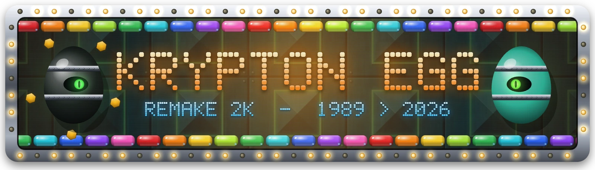
</p>

<p align="center">
  
</p>

<p align="center">
  
  
  
  
  
</p>

<p align="center"></p>

<table>
  <tr>
    <td width="96" align="center">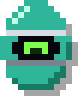</td>
    <td>
      <b>1989.</b> Un étudiant belge, Alexandre Kral, sort sur Atari ST et Amiga un casse-briques qui va faire chauffer les souris de toute une génération : <b>Krypton Egg</b>. Porté sur PC par C2V en 1994, il passe de disquette en disquette dans les cours de récré. À l'époque, le magazine <i>PC Loisirs</i> le présentait comme le meilleur casse-briques du monde.
      <br><br>
      <b>2026.</b> Le revoilà en <b>2560×1440</b>, dans ton navigateur. Briques en verre glossy, cadre en bois veiné, plaques de métal teal, HUD néon : tout est dessiné par le code au lancement. Pas un fichier image, pas un sample, pas un MP3. Les sons et les musiques sont synthétisés en direct par un mini-tracker maison.
    </td>
  </tr>
</table>

## ▓▒░ SCREENSHOTS ░▒▓

<p align="center">
  <a href="docs/readme/shot-hero.webp">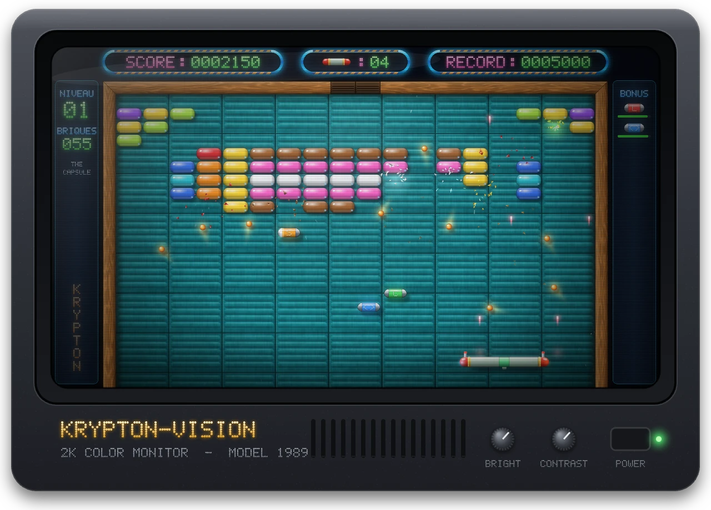</a>
  <br>
  <sub><b>NIVEAU 01 · THE CAPSULE</b> : neuf balles en jeu, lasers montés, raquette géante. Clique pour la capture en 1080p.</sub>
</p>

<table>
  <tr>
    <td align="center" width="50%">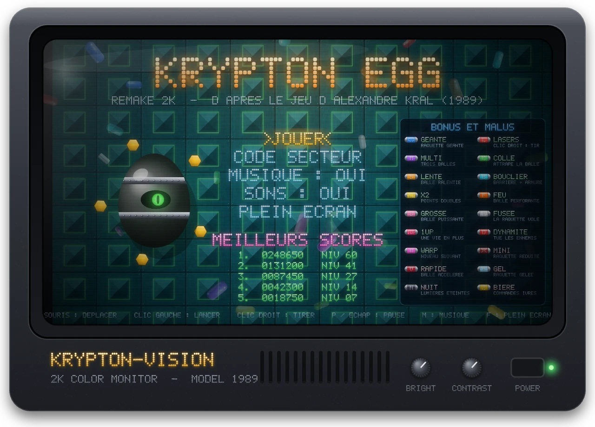<br><sub><b>ÉCRAN TITRE</b> : l'œuf te suit des yeux</sub></td>
    <td align="center" width="50%">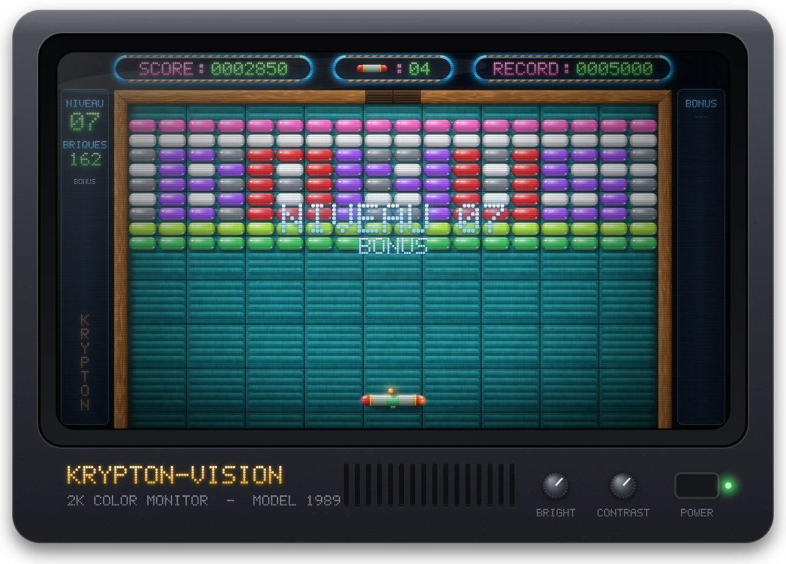<br><sub><b>NIVEAU 07 · BONUS</b> : les briques tombent en place</sub></td>
  </tr>
  <tr>
    <td align="center">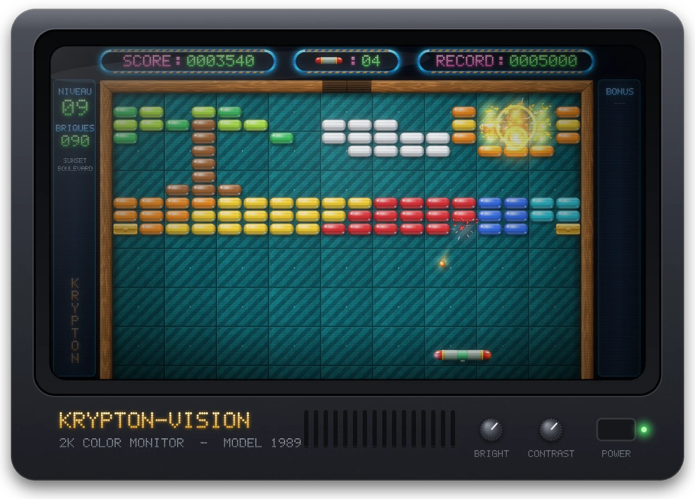<br><sub><b>NIVEAU 09 · SUNSET BOULEVARD</b> : réaction en chaîne d'explosifs</sub></td>
    <td align="center">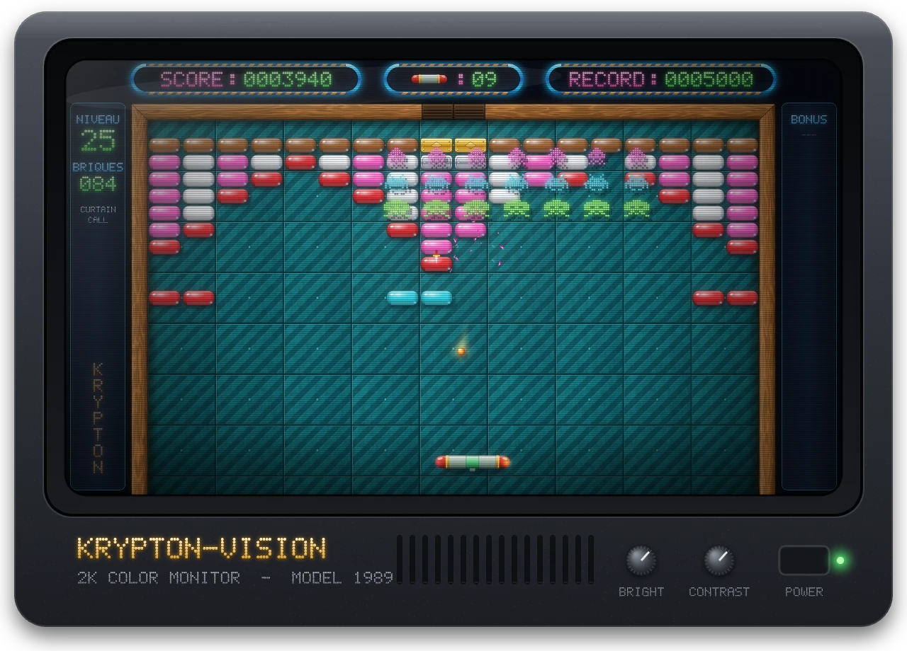<br><sub><b>NIVEAU 25 · CURTAIN CALL</b> : invasion, gare aux dagues</sub></td>
  </tr>
  <tr>
    <td align="center">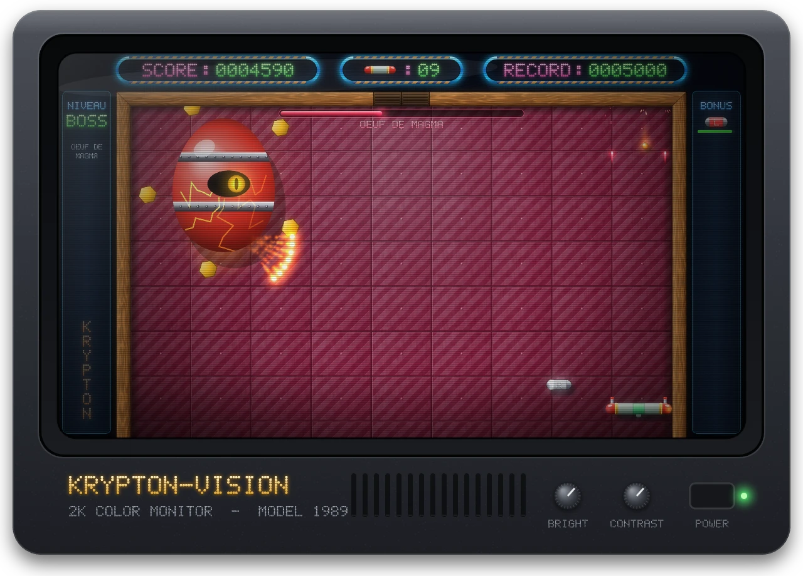<br><sub><b>BOSS 4 · ŒUF DE MAGMA</b> : rayon chargé et boules de feu</sub></td>
    <td align="center">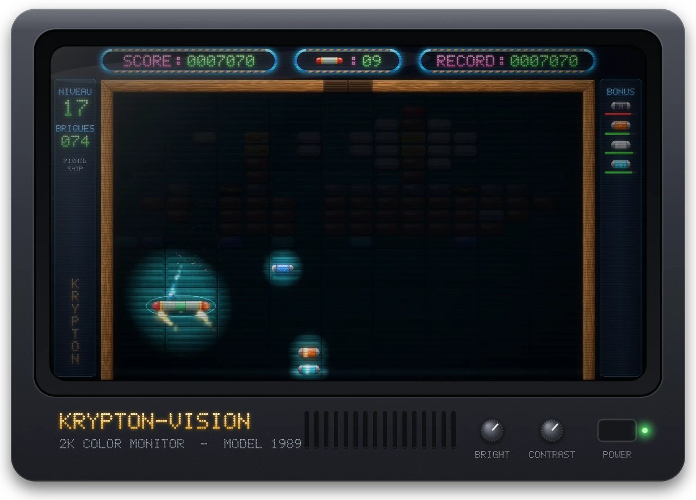<br><sub><b>NIVEAU 17 · PIRATE SHIP</b> : malus Nuit, balle de feu, fusée</sub></td>
  </tr>
</table>

<p align="center"></p>

## ▓▒░ INSÉREZ LA DISQUETTE ░▒▓

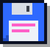

```text
╔══════════════════════════════════════════════╗
║  KRYPTON EGG 2K  ·  DISQUETTE 1 / 1          ║
║  CHARGEMENT ........................  100 %  ║
║  MÉMOIRE LIBRE : 640 Ko (ça devrait suffire) ║
╚══════════════════════════════════════════════╝
```

Il te faut **Node.js 22+**. Ensuite :

```bash
git clone https://github.com/DamienOriente/crypton-egg-game.git
cd crypton-egg-game
npm install
npm run dev
```

Le jeu tourne sur **http://127.0.0.1:5173**. Clique une fois pour réveiller la carte son.

| Commande | Effet |
|---|---|
| `npm run dev` | serveur de dev avec rechargement à chaud |
| `npm run build` | typecheck strict + bundle de prod dans `dist/` (≈ 60 Ko gzip) |
| `npm run preview` | sert le build de prod en local |

Une **salle d'écoute** permet de tester chaque bruitage, chaque musique et chaque jingle : **http://127.0.0.1:5173/audio-test.html** (en dev).

## ▓▒░ COMMANDES ░▒▓

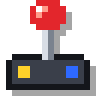

| Action | Souris | Clavier |
|---|---|---|
| Déplacer la raquette | bouger (capturée au premier clic) | <kbd>←</kbd> <kbd>→</kbd> ou <kbd>Q</kbd> <kbd>D</kbd> |
| Lancer la balle | <kbd>clic gauche</kbd> | <kbd>Espace</kbd> / <kbd>Entrée</kbd> |
| Tirer (bonus Lasers) | <kbd>clic droit</kbd> | <kbd>Espace</kbd> maintenu |
| Voler (bonus Fusée) | haut / bas | <kbd>↑</kbd> <kbd>↓</kbd> ou <kbd>Z</kbd> <kbd>S</kbd> |
| Pause et libérer la souris | | <kbd>P</kbd> / <kbd>Échap</kbd> |
| Musique / bruitages | | <kbd>M</kbd> / <kbd>N</kbd> |
| Plein écran | | <kbd>F</kbd> |

Sur écran tactile : glisse pour déplacer, touche pour lancer.

<p align="center"></p>

## ▓▒░ CONTENU DE LA CARTOUCHE ░▒▓


```text
 ╔═════════════════════ HI-SCORES ══════════════════════╗
 ║  1ST   60 NIVEAUX INSPIRÉS DES ORIGINAUX     999 999 ║
 ║  2ND   6 BOSS « ŒUF KRYPTON »                 60 000 ║
 ║  3RD   18 BONUS ET MALUS                      25 000 ║
 ║  4TH   6 VAGUES D'ENVAHISSEURS                12 000 ║
 ║  5TH   5 CODES SECTEUR À DÉCOUVRIR             5 000 ║
 ╚══════════════════════════════════════════════════════╝
```

**Les briques**
- **Couleur** : un coup suffit. Chaque brique cassée sans retoucher la raquette monte d'une note dans la gamme : enchaîne les combos et le jeu joue une mélodie.
- **Argent** : deux coups (trois à partir du niveau 31), elle se fissure avant de céder.
- **Or** : indestructible. Il faut faire avec.
- **Régénérante** : elle revient au bout de 8 secondes. Le niveau n'est fini que quand toutes sont à terre en même temps.
- **Explosive** : elle souffle ses 8 voisines, et les explosions se propagent en chaîne.
- **Téléporteurs** : la balle entre dans un portail et ressort par son jumeau.

Tu démarres avec **4 vies**. Une vie bonus tombe à 20 000, 60 000 et 120 000 points, puis tous les 100 000.

<p align="center"></p>

## ▓▒░ BONUS & MALUS ░▒▓

Environ une brique sur neuf lâche une capsule. Attrape-la avec la raquette… ou évite-la.

<table>
  <tr>
    <td align="center" width="33%"><br><b>GÉANTE</b><br><sub>raquette géante, 25 s</sub></td>
    <td align="center" width="33%"><br><b>LASERS</b><br><sub>double canon sur clic droit, 20 s</sub></td>
    <td align="center" width="33%"><br><b>MULTI</b><br><sub>chaque balle se divise en trois</sub></td>
  </tr>
  <tr>
    <td align="center"><br><b>COLLE</b><br><sub>la raquette attrape la balle, 20 s</sub></td>
    <td align="center"><br><b>LENTE</b><br><sub>balle ralentie, 15 s</sub></td>
    <td align="center"><br><b>BOUCLIER</b><br><sub>barrière au sol + immunité, 15 s</sub></td>
  </tr>
  <tr>
    <td align="center"><br><b>X2</b><br><sub>points doublés, 20 s</sub></td>
    <td align="center"><br><b>FEU</b><br><sub>traverse les briques (sauf l'or), 10 s</sub></td>
    <td align="center"><br><b>GROSSE</b><br><sub>grosse balle, double impact, 15 s</sub></td>
  </tr>
  <tr>
    <td align="center"><br><b>FUSÉE</b><br><sub>la raquette décolle, 18 s</sub></td>
    <td align="center"><br><b>1UP</b><br><sub>une vie en plus</sub></td>
    <td align="center"><br><b>DYNAMITE</b><br><sub>pulvérise tous les ennemis</sub></td>
  </tr>
  <tr>
    <td align="center"><br><b>WARP</b><br><sub>passe direct au niveau suivant</sub></td>
    <td align="center"><br><b>✖ MINI</b><br><sub>raquette réduite, 20 s</sub></td>
    <td align="center"><br><b>✖ RAPIDE</b><br><sub>balle accélérée, 12 s</sub></td>
  </tr>
  <tr>
    <td align="center"><br><b>✖ GEL</b><br><sub>raquette paralysée, 2 s</sub></td>
    <td align="center"><br><b>✖ NUIT</b><br><sub>extinction des feux, 12 s</sub></td>
    <td align="center"><br><b>✖ BIÈRE</b><br><sub>commandes qui tanguent, 10 s</sub></td>
  </tr>
</table>

<p align="center"></p>

## ▓▒░ LE BESTIAIRE ░▒▓

Ils sortent par la trappe en haut du cadre. La plupart se contentent de dévier la balle. Le **rayon incandescent**, lui, détruit la raquette au contact, sauf sous bouclier.

<p align="center">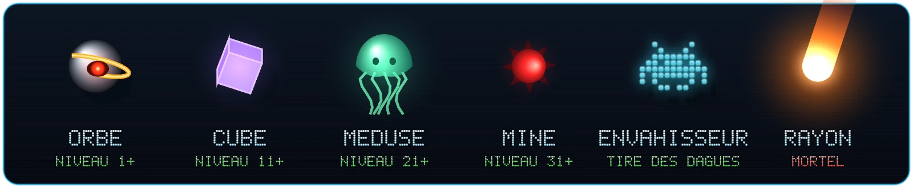</p>

Aux niveaux **5, 15, 25, 35, 45 et 55**, une formation d'envahisseurs défile au-dessus des briques et lâche des dagues : la musique de marche à 4 notes accélère à mesure que la formation se vide.

Tous les 10 niveaux, un **Œuf Krypton** géant défend le secteur : tirs en éventail, mines, rayon chargé, plaques d'or en orbite, pluie de feu. Chaque boss vaincu révèle un **code secteur**.

<p align="center">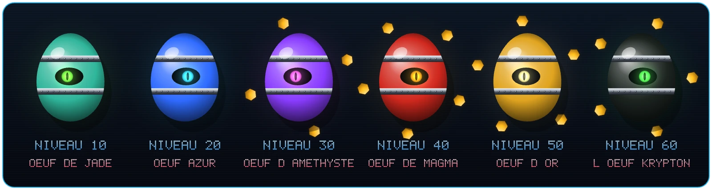</p>

## ▓▒░ LES 60 TABLEAUX ░▒▓

Capsule, soleil couchant, théière, bateau pirate, « HAHA », « THE END », « HOPE »… les 60 tableaux reprennent les motifs des niveaux d'origine, adaptés à une grille de 18 × 13.

<details>
  <summary><b>OUVRIR LA PLANCHE DES 60 NIVEAUX</b></summary>
  <br>
  <p align="center">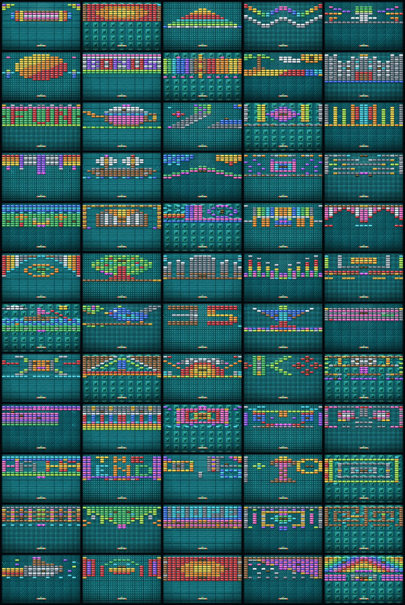</p>
</details>

## ▓▒░ TRUCS & ASTUCES ░▒▓

> *Rubrique façon magazine de 1994 : à lire avec un Banga et une disquette de démo à la main.*

- La balle part avec l'angle où elle touche la raquette : vise avec les bords.
- Avec la **Colle**, tu choisis le moment du tir : idéal pour les niveaux à régénérantes.
- Les **lasers** abîment aussi le boss, mais c'est la balle qui fait le plus mal.
- Sous **Fusée**, monter la raquette au contact de la balle lui donne un coup d'accélérateur.

<details>
  <summary><b>⚠ SPOILER : LES CODES SECTEUR</b></summary>
  <br>

| Code | Reprendre au niveau |
|:---:|:---:|
| `NEON` | 11 |
| `ARGO` | 21 |
| `XENO` | 31 |
| `RADO` | 41 |
| `HELI` | 51 |

À taper dans **CODE SECTEUR** sur l'écran titre. Les gaz nobles, la famille du krypton.
</details>

## ▓▒░ SOUS LE CAPOT ░▒▓

- **Rendu** : Canvas 2D en résolution interne fixe 2560×1440, adaptée à la fenêtre. Sprites, plaques, bois et police dot-matrix générés au lancement puis mis en cache ; halos par sprites additifs (zéro `shadowBlur` en jeu).
- **Physique** : pas fixe à 120 Hz, balle sous-échantillonnée (≤ 6 px par sous-pas) : pas de balle qui traverse les briques à pleine vitesse.
- **Audio** : Web Audio pur. 55 bruitages synthétisés, 6 musiques et 5 jingles composés note par note pour un séquenceur maison, mixés avec compresseur et limiteur.
- **Zéro dépendance runtime** : Vite et TypeScript servent uniquement à développer et builder.

```text
src/
├── audio/     moteur Web Audio, instruments, séquenceur, morceaux
├── core/      maths, entrées (pointer lock, clavier, tactile), stockage
├── game/      partie, briques, boss, ennemis, bonus, HUD, écrans
├── levels/    les 60 niveaux en grilles ASCII
└── render/    sprites, décors, police dot-matrix, particules
```

## ▓▒░ CRÉDITS ░▒▓

- **Krypton Egg** original : Alexandre Kral (1989, Atari ST / Amiga), version PC par C2V (1994).
- **Remake 2K** : Damien Oriente. Graphismes, sons et musiques recréés de zéro ; aucun élément du jeu d'origine n'est réutilisé.
- Remake de fan, sans lien avec les ayants droit du jeu original.

<p align="center"></p>

<p align="center">
  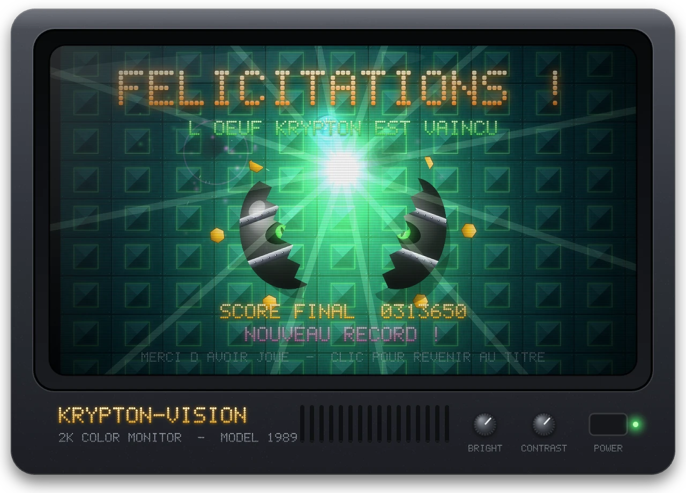
</p>

<p align="center">
  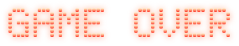
  <br>
  
</p>

<p align="center">
  <sub>Meilleure expérience en 2560×1440 · Souris à boule conseillée · Compatible Netscape Navigator : non</sub>
</p>

<p align="center"></p>

<p align="center"><b>Développé avec ❤️ pour mon pote Raph</b></p>
