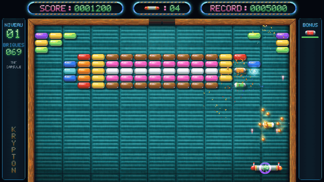

# Page itch.io — textes prêts à coller

Copie depuis le rendu GitHub de ce fichier (pas depuis le Markdown brut) : l'éditeur d'itch.io garde alors titres, gras et listes.

---

## Champs courts

| Champ itch.io | Valeur |
|---|---|
| **Title** | Krypton Egg — Remake 2K |
| **Short description or tagline** | Le casse-briques culte de 1989, refait en 2K. Jouable dans le navigateur. |
| **Classification** | Games |
| **Kind of project** | HTML (avec fichiers téléchargeables) |
| **Release status** | Released |
| **Genre** | Action |
| **Tags** (10 max) | `breakout`, `brick-breaker`, `arcade`, `retro`, `remake`, `boss-battle`, `power-ups`, `amiga`, `atari-st`, `singleplayer` |
| **Input** | Mouse, Keyboard, Touchscreen |
| **Languages** | French |
| **Accessibility** | — |
| **Average session** | A few minutes |

---

## Description — Français

### Le casse-briques de 1989, en 2K

**Krypton Egg** est sorti en 1989 sur Atari ST et Amiga. Ce remake le ramène en **2560×1440**, avec des briques en verre glossy, un cadre en bois veiné, un HUD néon… et **pas un seul fichier image ni sample** : tout est dessiné et synthétisé par le code, en direct.

### Au programme

- **60 tableaux** et **6 boss « Œuf Krypton »** qui font trembler l'écran à leur arrivée
- **18 bonus et malus** : lasers, multi-balles, raquette-fusée, bouclier… et la bière, qui fait tanguer les commandes
- Briques en or indestructibles, briques qui repoussent, explosifs en chaîne, téléporteurs
- Vagues d'**envahisseurs** qui lâchent des dagues
- **Codes secteur** pour reprendre là où tu t'étais arrêté
- Musiques et bruitages **synthétisés en temps réel**, avec une note de plus à chaque brique enchaînée
- Un **générique de fin** façon jeu AAA… où tous les postes sont tenus par la même personne

### Commandes

| Action | Souris | Clavier |
|---|---|---|
| Déplacer la raquette | souris | ← → |
| Lancer la balle | clic gauche | Espace |
| Tirer (bonus Lasers) | clic droit | Espace maintenu |
| Pause | | Échap |
| Plein écran | | F |

Sur écran tactile : glisse pour déplacer, touche pour lancer.
Touches bonus pour les plus pressés : **P** pour une barrière permanente, **M** pour tripler les balles.

### Plateformes

- **Navigateur** : clique sur *Run game*, puis dans le jeu pour activer le son.
- **Windows** : décompresse, lance `Krypton Egg.exe`. Si SmartScreen s'affiche : *Informations complémentaires → Exécuter quand même*.
- **Mac** (Intel et Apple Silicon) : décompresse, glisse `Krypton Egg.app` dans Applications. Au premier lancement : *Réglages Système → Confidentialité et sécurité → Ouvrir quand même*.

### Crédits

Remake de fan par **Diginumia Game Studio**, d'après *Krypton Egg* d'Alexandre Kral (1989). Graphismes, sons et musiques recréés de zéro.

*Développé avec ❤️ pour mon pote Raph.*

---

## Description — English

### The 1989 brick-breaker, rebuilt in 2K

**Krypton Egg** came out in 1989 on the Atari ST and Amiga. This remake brings it back in **2560×1440**, with glossy glass bricks, a wood-grain frame, a neon HUD… and **not a single image or sample file**: everything is drawn and synthesized by code, live.

### Features

- **60 levels** and **6 "Krypton Egg" bosses** that shake the screen when they land
- **18 power-ups and power-downs**: lasers, multi-ball, rocket paddle, shield… and beer, which makes the controls sway
- Indestructible gold bricks, regrowing bricks, chain-reacting explosives, teleporters
- **Invader** waves dropping daggers
- **Sector codes** to pick up where you left off
- Music and sound effects **synthesized in real time**, one note higher for every brick in a combo
- AAA-style **end credits**… where every job is held by the same person

### Controls

| Action | Mouse | Keyboard |
|---|---|---|
| Move the paddle | mouse | ← → |
| Launch the ball | left click | Space |
| Fire (Lasers power-up) | right click | hold Space |
| Pause | | Esc |
| Fullscreen | | F |

On touch screens: drag to move, tap to launch.
Helper keys: **P** for a permanent barrier, **M** to triple the balls.

### Platforms

- **Browser**: click *Run game*, then click inside the game to enable sound.
- **Windows**: unzip, run `Krypton Egg.exe`. If SmartScreen shows up: *More info → Run anyway*.
- **Mac** (Intel and Apple Silicon): unzip, drag `Krypton Egg.app` to Applications. On first launch: *System Settings → Privacy & Security → Open Anyway*.

The game is in French.

### Credits

Fan remake by **Diginumia Game Studio**, based on *Krypton Egg* by Alexandre Kral (1989). Graphics, sound and music recreated from scratch.

*Made with ❤️ for my buddy Raph.*
